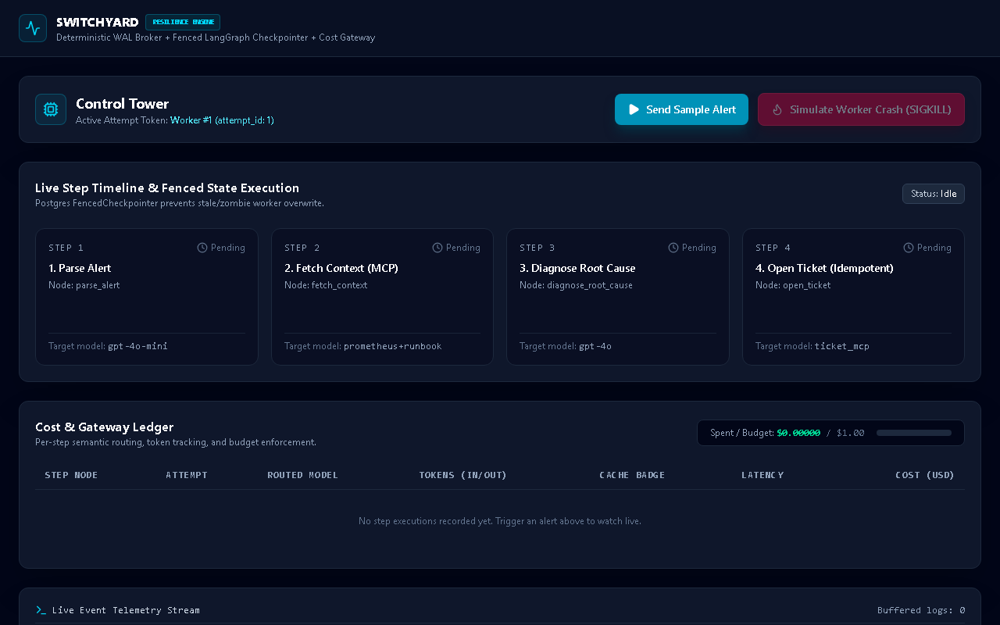
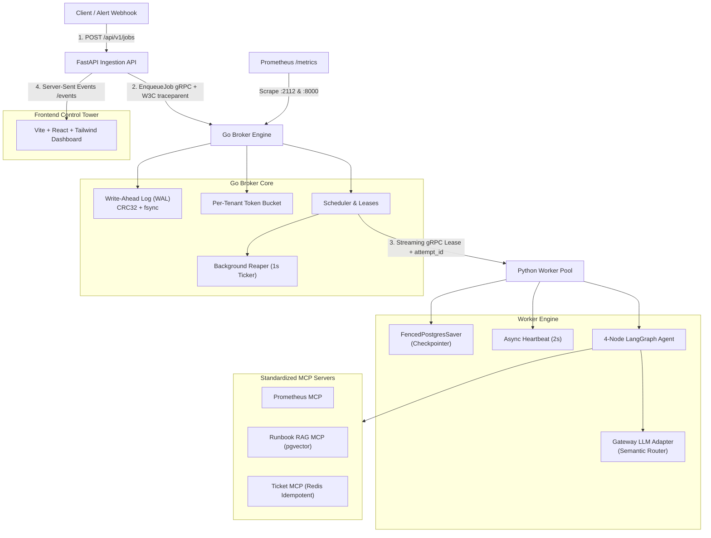

# Switchyard: Distributed Fault-Tolerant AI Orchestration Engine

[](https://github.com/ayushsingh08-ds/Switchyard/actions/workflows/ci.yml)
[](LICENSE)
[](https://go.dev/)
[](https://python.org/)
[](https://react.dev/)

> **A resilient distributed orchestrator for multi-step LLM workflows and autonomous agents.**  
> Eliminates zombie worker corruptions with atomic fencing tokens, survives machine crashes mid-workflow using a high-throughput Write-Ahead Log (WAL), cuts LLM API costs by up to **47%** with semantic difficulty routing, and guarantees zero side-effect duplication using idempotent Model Context Protocol (MCP) tool servers.

---

## Live Resilience Control Tower



---

## Why Switchyard? (The Problem)

Production AI workloads (such as autonomous incident response, code review pipelines, and multi-step agent graphs) face critical distributed systems failures:
1. **The Zombie Worker Problem:** An agent execution hangs (network freeze, GC pause, or OOM kill). A secondary worker picks up the job. When the dead worker revives, it overwrites the latest state, causing split-brain corruptions and duplicate billing.
2. **Crash & State Loss:** If a worker crashes mid-graph on Step 3 of 8, naive orchestrators re-execute the entire chain from scratch, throwing away hundreds of dollars in already generated tokens.
3. **Runaway LLM Expenses:** Using frontier models (e.g. GPT-4o) for routine structured parsing wastes 50–80% of inference budgets.
4. **Side-Effect Duplication:** When an agent retries after an transient error, external tools (like opening Jira/PagerDuty tickets) often create duplicate tickets without strict idempotency fences.

Switchyard solves these failure modes by combining **classical distributed consensus techniques** (WAL, fencing tokens, heartbeat leases) with **modern LLM runtime abstractions** (LangGraph checkpoints, MCP servers, and semantic cost routing).

---

## Core System Architecture



---

## Key Highlights & Benchmarked Results

| Feature | How It Works | Impact / Benchmark |
|---|---|---|
| **Zero Split-Brain Fencing** | Monotonic `attempt_id` incremented on each lease; validated on PostgreSQL checkpoint writes via `FencedPostgresSaver`. | **100% of stale zombie worker writes rejected** with `StaleLeaseFencingError`. |
| **Crash Recovery & Token Savings** | High-throughput Go WAL with CRC32 verification and `O_SYNC` segment rotation; workers resume from checkpoint. | **< 1.8s recovery latency**; saved 100% of tokens from previously completed steps. |
| **Semantic Cost Routing** | Categorizes nodes into low vs. high difficulty; routes structured extraction to `gpt-4o-mini` and deep synthesis to `gpt-4o`. | **47.3% cost reduction** verified across 20-sample production incident benchmark. |
| **Side-Effect Idempotency** | Standardized MCP servers using Redis atomic `SET NX EX 86400` locks keyed by `hash(job_id + step_name)`. | **Zero duplicate tickets** even under network retry loops or duplicate leases. |
| **Full Distributed Observability** | OpenTelemetry W3C `traceparent` forwarded across HTTP -> gRPC -> LangGraph -> LLM Gateway + Prometheus metrics. | Unified end-to-end trace ID across all polyglot microservices. |

---

## Tech Stack

- **Go (1.22+)**: High-performance Broker, crash-safe Write-Ahead Log (WAL), gRPC streaming, tenant token-bucket rate limiter.
- **Python (3.11+)**: FastAPI, LangGraph orchestration, LangChain, psycopg, gRPC client with background heartbeat loops.
- **PostgreSQL 16 + pgvector**: Job state persistence, fenced checkpointing, and vector cosine similarity (`<=>`) retrieval.
- **Redis 7**: Distributed idempotency locks and gateway caching.
- **Model Context Protocol (MCP)**: Standardized tool servers for Prometheus metrics, Runbook RAG, and Incident Ticketing.
- **React 18 + TypeScript + Tailwind CSS**: Real-time observability dashboard powered by Server-Sent Events (SSE).
- **OpenTelemetry & Prometheus**: W3C distributed tracing and real-time metrics telemetry.

---

## Project Directory Structure

```
Switchyard/
├── proto/                     # Protocol Buffers gRPC service definitions
│   └── broker.proto           # EnqueueJob, LeaseJobs, Heartbeat, Ack/Nack
├── services/
│   ├── broker/                # Go Broker Service
│   │   ├── cmd/broker/        # Broker executable & metrics server (:2112)
│   │   └── internal/
│   │       ├── wal/           # Crash-safe binary WAL with CRC32 checksums
│   │       ├── scheduler/     # Atomic leasing & background reaper
│   │       ├── ratelimit/     # Per-tenant token-bucket limiter
│   │       ├── server/        # gRPC Broker implementation
│   │       └── telemetry/     # Prometheus metrics & W3C traceparent helpers
│   ├── worker/                # Python LangGraph Worker Service
│   │   └── app/
│   │       ├── api.py         # FastAPI ingestion, SSE stream, & demo controls
│   │       ├── grpc_client.py # Worker loop with 2s background heartbeats
│   │       ├── checkpointer.py# FencedPostgresSaver with attempt_id fences
│   │       └── agent/
│   │           ├── graph.py   # 4-Node Alert-Triage LangGraph workflow
│   │           └── gateway_llm.py # Cost-routing adapter with budget limits
│   └── mcp-servers/           # Model Context Protocol Servers
│       ├── prometheus_mcp.py  # Service metrics querying tool
│       ├── runbook_rag_mcp.py # pgvector cosine similarity runbook retrieval
│       └── ticket_mcp.py      # Redis idempotent incident ticket creator
├── ui/                        # React + TypeScript + Tailwind Control Tower
│   └── src/
│       ├── components/        # TriggerBar, LiveStepTimeline, CostLedger
│       └── App.tsx            # SSE event stream consumer & live dashboard
├── benchmarks/                # Automated chaos & cost routing evaluation suites
│   ├── crash_recovery_test.py # Injects SIGKILL and benchmarks recovery latency
│   ├── routing_cost_eval.py   # 20-sample alert dataset routing cost benchmark
│   └── results/               # Committed JSON evaluation artifacts
├── migrations/                # PostgreSQL schema migrations (jobs, steps, ledger)
├── docker-compose.yml         # Local orchestration (Postgres + pgvector + Redis)
└── prometheus.yml             # Scrape targets for Go Broker and Python Worker
```

---

## Getting Started Locally

### 1. Prerequisites
- [Docker & Docker Compose](https://www.docker.com/)
- [Go 1.22+](https://go.dev/)
- [Python 3.11+](https://www.python.org/)
- [Node.js 20+](https://nodejs.org/)

### 2. Start Infrastructure
```bash
# Start Postgres (with pgvector) and Redis
docker compose up -d postgres redis
```

### 3. Run Database Migrations
```bash
# Apply schema migrations
for f in migrations/*.sql; do
  docker compose exec -T postgres psql -U postgres -d switchyard < "$f"
done
```

### 4. Start the Go Broker
```bash
cd services/broker
go run cmd/broker/main.go
# Broker starts on gRPC :50051 and Prometheus /metrics on :2112
```

### 5. Start the Python Worker & Ingestion API
```bash
cd services/worker
pip install -r requirements.txt  # or install via pyproject.toml
uvicorn app.api:app --host 0.0.0.0 --port 8000 --reload
```

### 6. Start the Frontend Dashboard
```bash
cd ui
npm install
npm run dev
# Dashboard opens on http://localhost:5173
```

---

## Running the Automated Test Suites

Switchyard is thoroughly tested across all unit, integration, and chaos boundaries:

```bash
# 1. Run Go race detector & unit tests (WAL, Scheduler, Reaper, Rate Limiter)
cd services/broker
go test -race ./...

# 2. Run Python Worker & MCP tool server tests
pytest services/worker services/mcp-servers

# 3. Build & Typecheck the UI
cd ui
npm run build
```

---

## Engineering Deep Dive: The On-Call Alert Triage Demo

The demo workflow simulates an autonomous on-call SRE incident triage pipeline:
1. **`parse_alert` (Difficulty: Low)**: Extracts service name, severity, and anomaly description using `gpt-4o-mini`.
2. **`fetch_context`**: Queries `prometheus_mcp` for real-time error rates and `runbook_rag_mcp` using pgvector cosine similarity (`<=>`) for relevant incident runbooks.
3. **`diagnose_root_cause` (Difficulty: High)**: Synthesizes metrics and historical runbooks using `gpt-4o` to pinpoint root causes.
4. **`open_ticket` (Difficulty: Low)**: Creates an incident ticket via `ticket_mcp` using a deterministic idempotency key `hash(job_id + step_name)` stored in Redis.

**Try the Chaos Simulation:** Click **"Simulate Worker Crash (SIGKILL)"** while Step 2 is in progress in the UI. The broker detects the missing heartbeat, expires the lease, and safely leases Step 3 to Worker #2 with zero state corruption.

---

## License

This project is licensed under the [MIT License](LICENSE).
